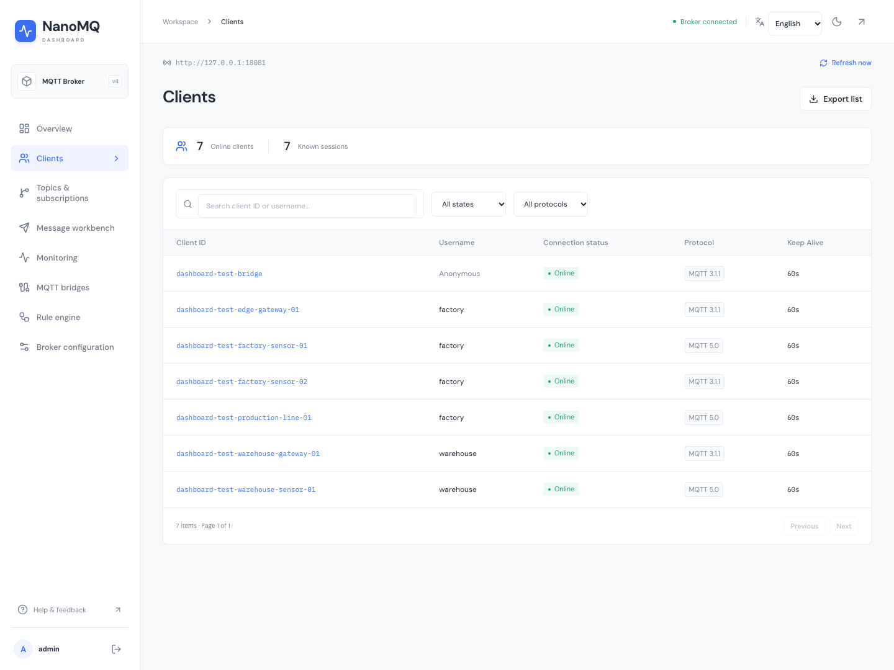
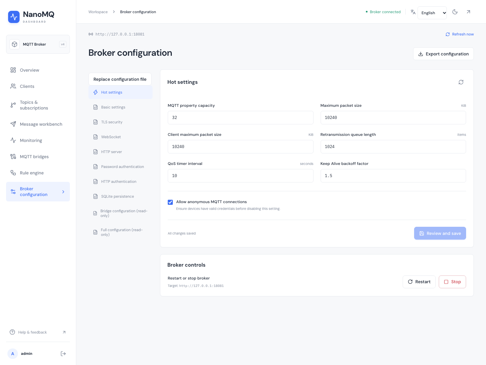
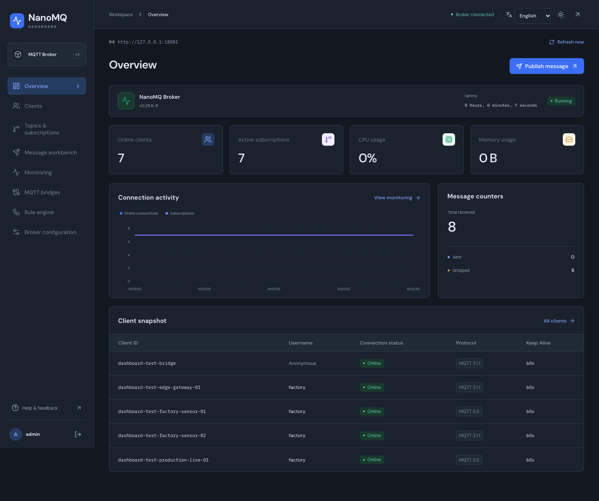

# NanoMQ Dashboard

[English](README.md) · [简体中文](README.zh-CN.md) · [API contract](docs/API.md) · [MIT License](LICENSE)

A focused operations console for NanoMQ HTTP API v4. Built with Next.js 16, React 19 and TypeScript 7.


## Features

- **Overview:** actual broker/node state, online connections, subscriptions, CPU, resident memory and global message counters.
- **Clients:** search by client ID or username, filter by connection state and MQTT version, paginate, inspect sessions/subscriptions and export JSON.
- **Topics and subscriptions:** searchable, QoS-filtered subscription lists and the broker's topic hierarchy.
- **Message workbench:** single and batch publishing, QoS 0/1/2, retain, empty payloads, broker-side Base64 encoding/decoding, JSON validation/formatting, MQTT 5 properties and per-message batch results.
- **Monitoring:** 5-second polling, connection/CPU/message charts, actual elapsed-time rates, pause/resume and sample export. Polls never overlap and stop while the tab is hidden.
- **Rules:** list, create, edit, enable, disable and delete rules. Republish and database actions use the broker's installed modules.
- **MQTT bridges:** inspect existing bridge nodes, enable/disable bridges and manage remote subscriptions; create/edit/remove nodes through the configuration file workflow.
- **Configuration:** read real broker sections; edit basic, TLS, WebSocket, HTTP, password/HTTP authentication and SQLite settings; update seven supported hot parameters; replace the HOCON file; explicitly confirm restart/stop.
- **Sessions:** Basic or JWT authentication, encrypted HttpOnly cookies, 12-hour expiration, broker target allowlisting, same-origin writes and a bounded, validated proxy.
- English and Simplified Chinese across the interface, including dialogs, validation and connection errors.
- Responsive layouts, dark mode, keyboard-accessible dialogs and self-hosted fonts. No external font service is needed.

There is **no mock/demo mode, random telemetry or success fallback**. Unsupported operations are not presented as working controls. Missing metrics display `—`; failed reads expose errors and label retained snapshots as stale.

NanoMQ 0.25.6 advertises some operations it does not route. Ordinary client subscribe/unsubscribe writes and bridge creation/deletion are unavailable in that release. Clients manage their own subscriptions; new bridges are configured through HOCON. See [verified API boundaries](docs/API.md).

## Interface language

Choose **English** or **中文** on the connection page or in the console header. The initial language follows your browser preferences; unsupported languages fall back to English. An explicit choice is saved in the `nanomq-language` cookie for one year and used for server rendering. Switching languages keeps your session, page and form edits. Broker data, MQTT topics and configuration keys keep their original values.

## Quick start

Requirements: **Node.js 22.12+** (Node.js 24 LTS recommended), npm, and a reachable NanoMQ broker with HTTP API enabled.

```bash
git clone https://github.com/visoar/nanomq-dashboard.git
cd nanomq-dashboard
npm ci
cp .env.example .env.local
npm run dev
```

Open [http://localhost:3000](http://localhost:3000), enter the broker HTTP URL and its existing Basic credentials or JWT. The example broker config uses `admin` / `public` for local development; use your actual production credentials.

A minimal broker configuration is provided in [deploy/nanomq.conf](deploy/nanomq.conf). Start NanoMQ with HTTP enabled:

```bash
nanomq start --conf /path/to/nanomq.conf --http
```

The broker URL must be reachable **from the Next.js server**. In containers, `localhost` refers to the dashboard container, not the host or broker container. An optional `/api/v4` URL suffix is accepted and normalized.

## Environment

All variables are **server-side**. Never place broker credentials in `NEXT_PUBLIC_*` variables.

| Variable | Purpose | Default |
| --- | --- | --- |
| `NANOMQ_API_URL` | Default permitted broker base URL | `http://127.0.0.1:8081` |
| `NANOMQ_ALLOWED_URLS` | Additional permitted base URLs, comma-separated; exact origin and base path | Empty |
| `NANOMQ_SESSION_SECRET` | At least 32 characters; required in production; identical across replicas | Ephemeral key in development |
| `NANOMQ_SECURE_COOKIE` | Set `true` for HTTPS, `false` only for local HTTP | `true` in production |

Generate a session secret with `openssl rand -hex 32`. Restart after changing environment variables. Rotating the secret invalidates existing sessions; development restarts also invalidate sessions without a configured secret.

```bash
npm run build
NANOMQ_SESSION_SECRET="your-generated-secret-at-least-32-characters" npm start
```

Serve production behind HTTPS. Forward the original `Host` and `X-Forwarded-Proto` headers when using a reverse proxy so the same-origin check sees the public URL. Configure private certificate authorities through Node's `NODE_EXTRA_CA_CERTS`; do not disable TLS verification.

## Docker

For an isolated local dashboard and NanoMQ 0.25.6 Full broker:

```bash
export NANOMQ_SESSION_SECRET="$(openssl rand -hex 32)"
docker compose up --build -d
```

Open [http://localhost:3000](http://localhost:3000). The connection form defaults to `http://broker:8081`; this address is resolved by the dashboard server. The example exposes the dashboard and MQTT listener on loopback only. Edit the broker credentials and authentication configuration before adapting it for production.

The mounted broker file is writable to support the explicit “replace configuration file” operation. Back it up before making configuration changes. `/reload` changes only the running process; section setters and the HOCON file endpoint have different persistence semantics. The UI rereads section values after a write and warns if they differ.

## Verification

```bash
npm run lint
npm run typecheck
npm test
npm run build
```

Browser tests require a **disposable real NanoMQ broker**, not production. They open real MQTT connections, publish real messages, change and restore hot settings, manage a test rule/bridge, and write then restore a configuration file. No HTTP responses are mocked.

```bash
docker run -d --name nanomq-dashboard-test \
  -p 127.0.0.1:18081:8081 -p 127.0.0.1:18884:1883 \
  -v "$PWD/deploy/nanomq.test.conf:/etc/nanomq.conf" \
  emqx/nanomq:0.25.6-full --conf /etc/nanomq.conf --http
npx playwright install chromium
npm run test:e2e
npm run screenshots
docker rm -f nanomq-dashboard-test
```

Use `TEST_BROKER_URL`, `TEST_MQTT_URL`, `TEST_BROKER_USERNAME`, `TEST_BROKER_PASSWORD` and `TEST_BROKER_CONFIG_PATH` when testing a separately started broker. The default HTTP/MQTT ports are `18081`/`18884`; the default configuration path is `deploy/nanomq.test.conf`. A bridge named `test-edge` and a build with rule engine support are required by management tests.

Screenshots in this repository are captured from this application connected to a real NanoMQ 0.25.6 broker, with disposable MQTT test clients. Both language versions are captured from the same live application. These are not design mockups or injected dashboard responses. Upstream reports CPU/memory as zero on macOS; Linux provides process resource measurements.

## Structure and migration

```text
src/app/                 Pages and same-origin API routes
src/components/          Shared shell, tables, charts and dialogs
src/context/dashboard.tsx  Session bootstrap, polling and bounded history
src/context/language.tsx   Language selection and persistent preference
src/lib/i18n/             UI translations and localized diagnostics
src/lib/contracts.ts     Runtime schemas, metric parsing and counter rates
src/lib/server/          Session encryption, target policy and broker transport
src/lib/use-resource.ts   Page-scoped reads with cancellation
e2e/                    Real broker/browser integration tests
tests/                  Contract, policy and session tests
deploy/                 Broker configs for local use and integration tests
```

Version 2 replaces the unused admin template, duplicated Axios proxies, simulated configuration forms and random metrics. Legacy `nanomq-auth`/`nanomq-config` localStorage entries are removed on first load; reconnect once after upgrading. Replace old `NEXT_PUBLIC_NANOMQ_*` settings with the server variables above. `/statistics` redirects to the unified `/monitoring` page. There is no broker-side account registration endpoint, so the unused sign-up template was removed.

## Screenshots

### Clients



### Message workbench


### Configuration



<details>
<summary>Connection</summary>


</details>

<details>
<summary>Dark mode</summary>



</details>

<details>
<summary>Mobile</summary>


</details>

## License

[MIT](LICENSE). Bundled fonts retain their [DM Sans](public/fonts/OFL-DM-Sans.txt) and [IBM Plex Mono](public/fonts/OFL-IBM-Plex-Mono.txt) Open Font Licenses. This community dashboard is independent of the NanoMQ project.
