# NanoMQ Dashboard

A focused operations console for NanoMQ HTTP API v4. Built with Next.js 16, React 19 and TypeScript 7.

面向 NanoMQ HTTP API v4 的运维控制台，基于 Next.js 16、React 19 和 TypeScript 7 构建。

[English](#english) · [简体中文](#简体中文) · [API contract / API 契约](docs/API.md) · [MIT License](LICENSE)

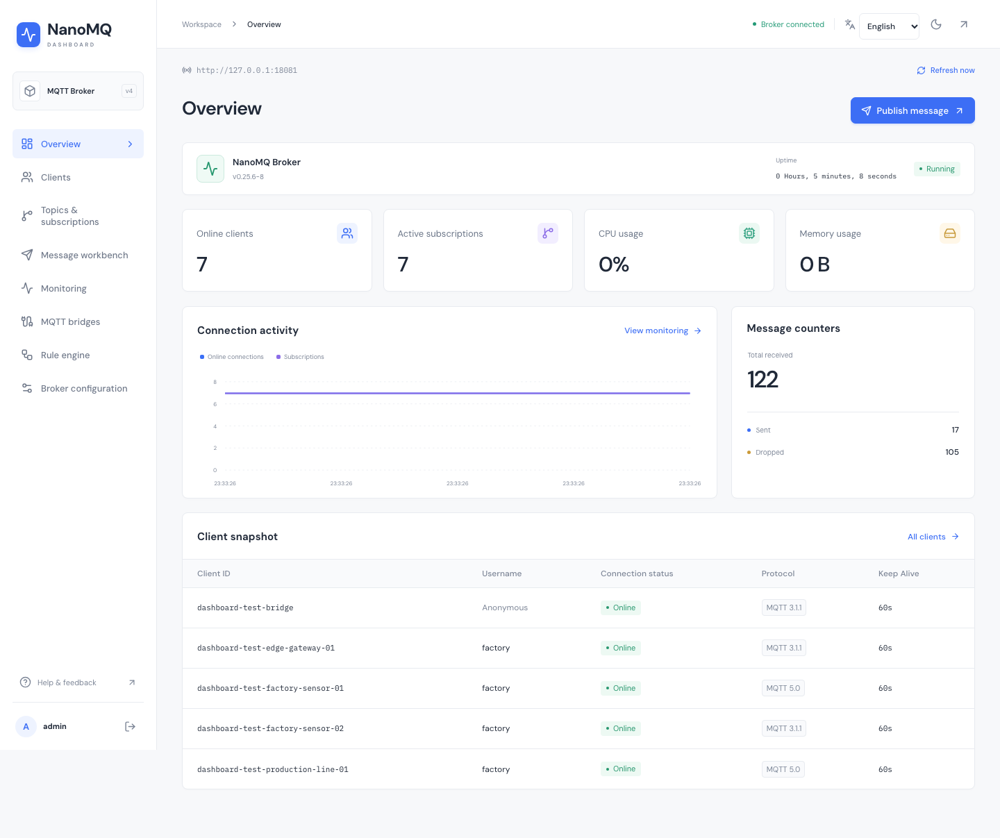

## English

### Features

- **Overview:** actual broker/node state, online connections, subscriptions, CPU, resident memory and global message counters.
- **Clients:** search by client ID or username, filter by connection state and MQTT version, paginate, inspect sessions/subscriptions and export JSON.
- **Topics and subscriptions:** searchable, QoS-filtered subscription lists and the broker's topic hierarchy.
- **Message workbench:** single and batch publishing, QoS 0/1/2, retain, empty payloads, broker-side Base64 encoding/decoding, JSON validation/formatting, MQTT 5 properties and per-message batch results.
- **Monitoring:** 5-second polling, connection/CPU/message charts, actual elapsed-time rates, pause/resume and sample export. Polls never overlap and stop while the tab is hidden.
- **Rules:** list, create, edit, enable, disable and delete rules. Republish and database actions use the broker's installed modules.
- **MQTT bridges:** inspect existing bridge nodes, enable/disable bridges and manage remote subscriptions; create/edit/remove nodes through the configuration file workflow.
- **Configuration:** read real broker sections; edit basic, TLS, WebSocket, HTTP, password/HTTP authentication and SQLite settings; update seven supported hot parameters; replace the HOCON file; explicitly confirm restart/stop.
- **Sessions:** Basic or JWT authentication, encrypted HttpOnly cookies, 12-hour expiration, broker target allowlisting, same-origin writes and a bounded, validated proxy.
- English and Simplified Chinese across the interface, including dialogs, validation and connection errors.
- Responsive layouts, dark mode, keyboard-accessible dialogs and self-hosted fonts. No external font service is needed.

There is **no mock/demo mode, random telemetry or success fallback**. Unsupported operations are not presented as working controls. Missing metrics display `—`; failed reads expose errors and label retained snapshots as stale.

NanoMQ 0.25.6 advertises some operations it does not route. Ordinary client subscribe/unsubscribe writes and bridge creation/deletion are unavailable in that release. Clients manage their own subscriptions; new bridges are configured through HOCON. See [verified API boundaries](docs/API.md#release-specific-boundaries--当前版本边界).

### Interface language

Choose **English** or **中文** on the connection page or in the console header. The initial language follows your browser preferences; unsupported languages fall back to English. An explicit choice is saved in the `nanomq-language` cookie for one year and used for server rendering. Switching languages keeps your session, page and form edits. Broker data, MQTT topics and configuration keys keep their original values.


<details>
<summary>English message workbench and mobile navigation</summary>

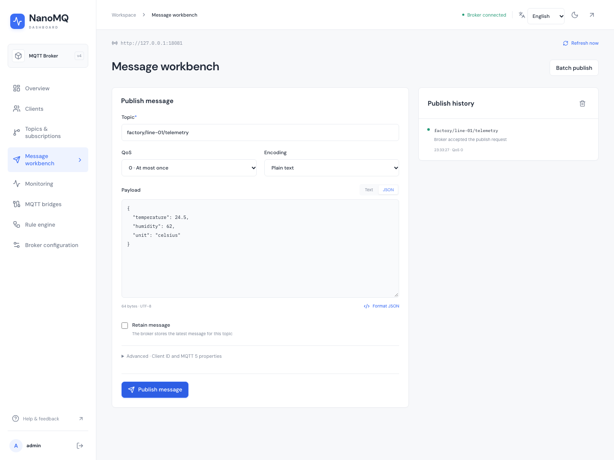

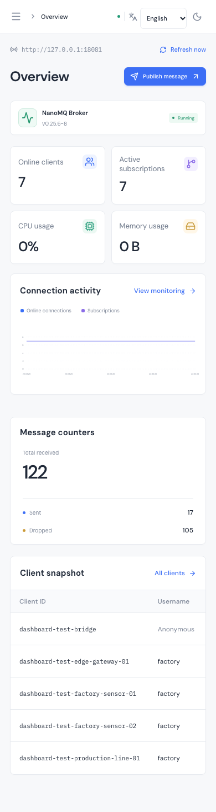

</details>

### Quick start

Requirements: **Node.js 22.12+** (Node.js 24 LTS recommended), npm, and a reachable NanoMQ broker with HTTP API enabled.

```bash
git clone https://github.com/visoar/nanomq-dashboard.git
cd nanomq-dashboard
npm ci
cp .env.example .env.local
npm run dev
```

Open [http://localhost:3000](http://localhost:3000), enter the broker HTTP URL and its existing Basic credentials or JWT. The example broker config uses `admin` / `public` for local development; use your actual production credentials.

A minimal broker configuration is provided in [deploy/nanomq.conf](deploy/nanomq.conf). Start NanoMQ with HTTP enabled:

```bash
nanomq start --conf /path/to/nanomq.conf --http
```

The broker URL must be reachable **from the Next.js server**. In containers, `localhost` refers to the dashboard container, not the host or broker container. An optional `/api/v4` URL suffix is accepted and normalized.

### Environment

All variables are **server-side**. Never place broker credentials in `NEXT_PUBLIC_*` variables.

| Variable | Purpose | Default |
| --- | --- | --- |
| `NANOMQ_API_URL` | Default permitted broker base URL | `http://127.0.0.1:8081` |
| `NANOMQ_ALLOWED_URLS` | Additional permitted base URLs, comma-separated; exact origin and base path | Empty |
| `NANOMQ_SESSION_SECRET` | At least 32 characters; required in production; identical across replicas | Ephemeral key in development |
| `NANOMQ_SECURE_COOKIE` | Set `true` for HTTPS, `false` only for local HTTP | `true` in production |

Generate a session secret with `openssl rand -hex 32`. Restart after changing environment variables. Rotating the secret invalidates existing sessions; development restarts also invalidate sessions without a configured secret.

```bash
npm run build
NANOMQ_SESSION_SECRET="your-generated-secret-at-least-32-characters" npm start
```

Serve production behind HTTPS. Forward the original `Host` and `X-Forwarded-Proto` headers when using a reverse proxy so the same-origin check sees the public URL. Configure private certificate authorities through Node's `NODE_EXTRA_CA_CERTS`; do not disable TLS verification.

### Docker

For an isolated local dashboard and NanoMQ 0.25.6 Full broker:

```bash
export NANOMQ_SESSION_SECRET="$(openssl rand -hex 32)"
docker compose up --build -d
```

Open [http://localhost:3000](http://localhost:3000). The connection form defaults to `http://broker:8081`; this address is resolved by the dashboard server. The example exposes the dashboard and MQTT listener on loopback only. Edit the broker credentials and authentication configuration before adapting it for production.

The mounted broker file is writable to support the explicit “replace configuration file” operation. Back it up before making configuration changes. `/reload` changes only the running process; section setters and the HOCON file endpoint have different persistence semantics. The UI rereads section values after a write and warns if they differ.

### Verification

```bash
npm run lint
npm run typecheck
npm test
npm run build
```

Browser tests require a **disposable real NanoMQ broker**, not production. They open real MQTT connections, publish real messages, change and restore hot settings, manage a test rule/bridge, and write then restore a configuration file. No HTTP responses are mocked.

```bash
docker run -d --name nanomq-dashboard-test \
  -p 127.0.0.1:18081:8081 -p 127.0.0.1:18884:1883 \
  -v "$PWD/deploy/nanomq.test.conf:/etc/nanomq.conf" \
  emqx/nanomq:0.25.6-full --conf /etc/nanomq.conf --http
npx playwright install chromium
npm run test:e2e
npm run screenshots
docker rm -f nanomq-dashboard-test
```

Use `TEST_BROKER_URL`, `TEST_MQTT_URL`, `TEST_BROKER_USERNAME`, `TEST_BROKER_PASSWORD` and `TEST_BROKER_CONFIG_PATH` when testing a separately started broker. The default HTTP/MQTT ports are `18081`/`18884`; the default configuration path is `deploy/nanomq.test.conf`. A bridge named `test-edge` and a build with rule engine support are required by management tests.

Screenshots in this repository are captured from this application connected to a real NanoMQ 0.25.6 broker, with disposable MQTT test clients. Both language versions are captured from the same live application. These are not design mockups or injected dashboard responses. Upstream reports CPU/memory as zero on macOS; Linux provides process resource measurements.

### Structure and migration

```text
src/app/                 Pages and same-origin API routes
src/components/          Shared shell, tables, charts and dialogs
src/context/dashboard.tsx  Session bootstrap, polling and bounded history
src/context/language.tsx   Language selection and persistent preference
src/lib/i18n/             UI translations and localized diagnostics
src/lib/contracts.ts     Runtime schemas, metric parsing and counter rates
src/lib/server/          Session encryption, target policy and broker transport
src/lib/use-resource.ts   Page-scoped reads with cancellation
e2e/                    Real broker/browser integration tests
tests/                  Contract, policy and session tests
deploy/                 Broker configs for local use and integration tests
```

Version 2 replaces the unused admin template, duplicated Axios proxies, simulated configuration forms and random metrics. Legacy `nanomq-auth`/`nanomq-config` localStorage entries are removed on first load; reconnect once after upgrading. Replace old `NEXT_PUBLIC_NANOMQ_*` settings with the server variables above. `/statistics` redirects to the unified `/monitoring` page. There is no broker-side account registration endpoint, so the unused sign-up template was removed.

## 简体中文

### 功能

- **运行总览**：展示真实 Broker/节点状态、在线连接、订阅、CPU、驻留内存及全局消息计数。
- **客户端**：按 ID 或用户名搜索，按连接状态和 MQTT 版本筛选，分页、查看会话与订阅、导出 JSON。
- **主题与订阅**：搜索订阅、按 QoS 筛选，查看 Broker 返回的主题层级。
- **消息工作台**：单条与批量发布、QoS 0/1/2、保留消息、空负载、Broker 端 Base64 编码/解码、JSON 校验与格式化、MQTT 5 属性、批量逐条回执。
- **实时监控**：每 5 秒采样，绘制连接、CPU、累计消息曲线，按实际时间计算速率；支持暂停、继续和导出。请求不重叠，页面隐藏时停止自动采样。
- **规则引擎**：查询、创建、修改、启用、停用、删除规则。重新发布和数据库动作使用 Broker 实际安装的模块。
- **MQTT 桥接**：查看、启停现有桥接，添加和取消远端订阅；通过配置文件流程创建、修改与移除桥接节点。
- **Broker 配置**：读取真实配置，编辑基础、TLS、WebSocket、HTTP、密码/HTTP 认证、SQLite 等章节；热更新七个实际支持的参数；替换完整 HOCON 文件；确认后重启或停止。
- **会话认证**：Basic/JWT、加密 HttpOnly Cookie、12 小时过期、Broker 地址白名单、同源写入检查、请求大小限制与参数校验。
- 界面完整支持简体中文与英文，覆盖弹窗、参数校验和连接错误。
- 支持响应式布局、深色模式、键盘操作和本地字体，不依赖外部字体服务。

项目**没有 mock、演示数据、随机指标或失败后伪造成功的逻辑**。不把上游未实现的操作包装成可用按钮；缺失指标显示 `—`，读取失败明确提示，并标记保留的数据可能已过期。

NanoMQ 0.25.6 的端点列表存在与实现不一致的情况：普通客户端订阅写接口、桥接创建与删除没有实际路由。客户端自行维护订阅，新增桥接通过 HOCON 配置完成。详见 [API 契约与版本边界](docs/API.md)。

### 界面语言

登录页和控制台顶部均可选择 **中文** 或 **English**。首次访问按浏览器语言选择，不支持的语言回退为英文。手动选择保存在 `nanomq-language` Cookie 中，有效期一年，刷新时由服务端直接输出对应语言。切换语言会保留会话、当前页面和未提交的表单；Broker 数据、MQTT 主题和配置字段保持原值。

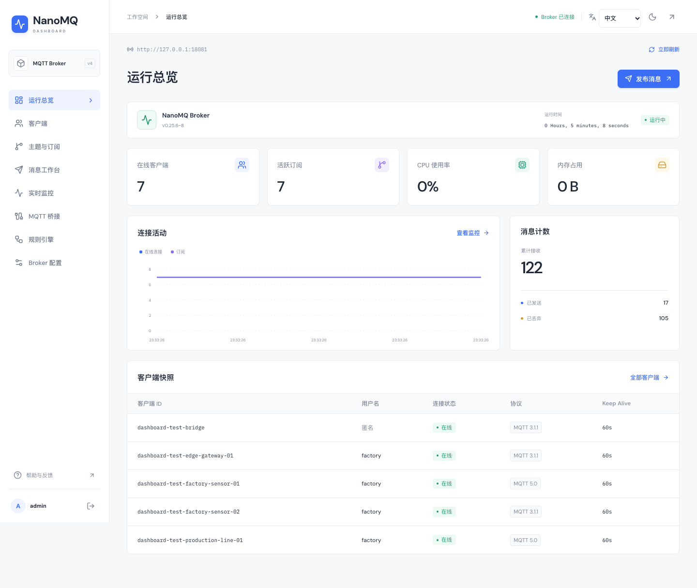

### 快速开始

需要 **Node.js 22.12+**（建议 Node.js 24 LTS）、npm，以及已启用 HTTP API 的 NanoMQ。

```bash
git clone https://github.com/visoar/nanomq-dashboard.git
cd nanomq-dashboard
npm ci
cp .env.example .env.local
npm run dev
```

访问 [http://localhost:3000](http://localhost:3000)，输入 Broker HTTP 地址及已有 Basic 凭据或 JWT。示例配置的 `admin` / `public` 仅用于本地开发，生产请使用自己的凭据。

可参考 [deploy/nanomq.conf](deploy/nanomq.conf)，以以下方式启用 HTTP API：

```bash
nanomq start --conf /path/to/nanomq.conf --http
```

Broker 地址必须能够由 **Next.js 服务端**访问。容器内的 `localhost` 指向当前容器，不能代替宿主机或另一个 Broker 容器。地址允许带 `/api/v4` 后缀，系统会规范化。

### 环境配置与部署

全部变量仅在服务端使用，不要通过 `NEXT_PUBLIC_*` 暴露凭据。

| 变量 | 说明 | 默认值 |
| --- | --- | --- |
| `NANOMQ_API_URL` | 默认允许连接的 Broker 地址 | `http://127.0.0.1:8081` |
| `NANOMQ_ALLOWED_URLS` | 额外允许的地址，逗号分隔，精确匹配源与基础路径 | 空 |
| `NANOMQ_SESSION_SECRET` | 至少 32 字符，生产必填，多副本保持一致 | 开发环境临时密钥 |
| `NANOMQ_SECURE_COOKIE` | HTTPS 设置 `true`，仅本地 HTTP 使用 `false` | 生产默认 `true` |

运行 `openssl rand -hex 32` 生成会话密钥。修改环境变量后重启；轮换密钥会使原会话失效。开发环境未配置固定密钥时，重启也需要重新登录。

```bash
npm run build
NANOMQ_SESSION_SECRET="替换为至少32字符的随机密钥" npm start
```

生产使用 HTTPS。反向代理应透传原始 `Host` 和 `X-Forwarded-Proto`，保证同源校验使用正确地址。私有 CA 可通过 Node 的 `NODE_EXTRA_CA_CERTS` 配置，不要关闭证书验证。

本地 Docker 一键启动控制台与 NanoMQ 0.25.6 Full：

```bash
export NANOMQ_SESSION_SECRET="$(openssl rand -hex 32)"
docker compose up --build -d
```

访问 [http://localhost:3000](http://localhost:3000)，连接页默认地址为 `http://broker:8081`，由面板服务端解析。示例仅将控制台与 MQTT 端口绑定至本地回环地址，改用于生产前请修改 Broker 凭据和认证设置。

挂载的 Broker 配置文件可写，以支持明确触发的“替换配置文件”操作。修改前备份；`/reload` 只改变当前进程，配置章节和文件写入的持久化方式不同。保存章节后，界面会重新读取当前值；读回不一致时会提示。

### 验证

```bash
npm run lint
npm run typecheck
npm test
npm run build
```

端到端测试必须连接**独立、可丢弃的真实 Broker**，不要对生产运行。测试会建立真实 MQTT 连接、收发消息、修改并恢复热参数、操作测试规则与桥接、写入并恢复配置文件，不拦截或模拟 HTTP 响应。

```bash
docker run -d --name nanomq-dashboard-test \
  -p 127.0.0.1:18081:8081 -p 127.0.0.1:18884:1883 \
  -v "$PWD/deploy/nanomq.test.conf:/etc/nanomq.conf" \
  emqx/nanomq:0.25.6-full --conf /etc/nanomq.conf --http
npx playwright install chromium
npm run test:e2e
npm run screenshots
docker rm -f nanomq-dashboard-test
```

外部启动的测试实例可通过 `TEST_BROKER_URL`、`TEST_MQTT_URL`、`TEST_BROKER_USERNAME`、`TEST_BROKER_PASSWORD` 和 `TEST_BROKER_CONFIG_PATH` 指定。默认 HTTP/MQTT 端口为 `18081`/`18884`，配置路径为 `deploy/nanomq.test.conf`；管理测试要求规则引擎及名为 `test-edge` 的桥接。

文档截图来自实际运行的面板和真实 NanoMQ 0.25.6，以及测试时连接的临时 MQTT 客户端，中英文截图均来自同一套实际界面，不是设计稿或注入响应。macOS 下上游 CPU/内存返回零，Linux 下会返回实际进程资源指标。

### 从旧版迁移

v2 清理未使用的后台模板，统一重复代理，替换模拟配置和随机指标。首次加载会删除旧版 `nanomq-auth`、`nanomq-config` 明文 localStorage 数据，需要重新连接一次；旧 `NEXT_PUBLIC_NANOMQ_*` 配置改为上表中的服务端变量。`/statistics` 跳转到统一监控页 `/monitoring`。Broker 没有账户注册接口，因此移除了未使用的注册模板。

## Screenshots / 界面截图

### Language switch / 语言切换

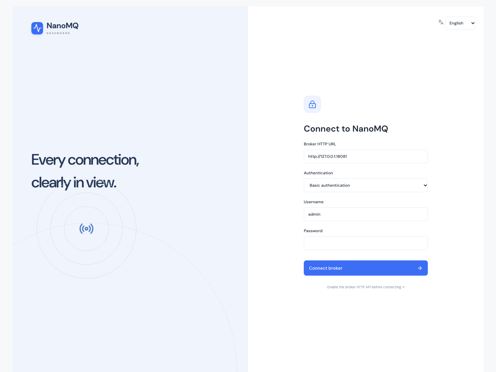

### Clients / 客户端

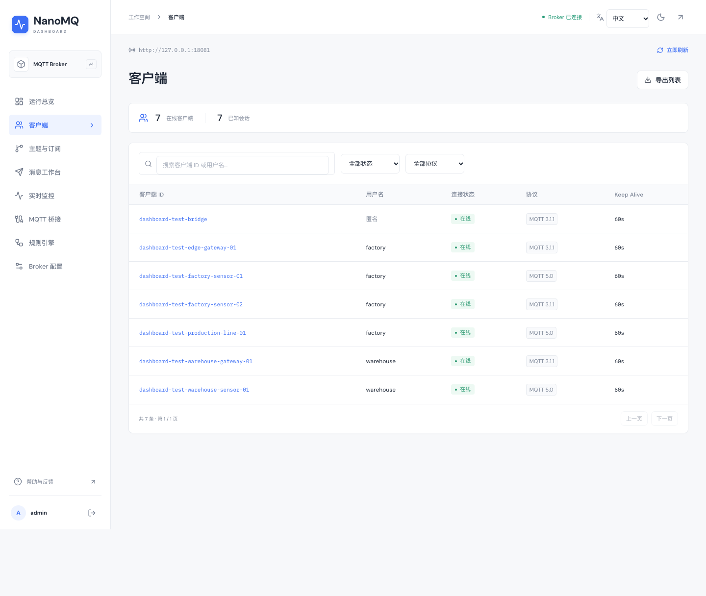

### Message workbench / 消息工作台

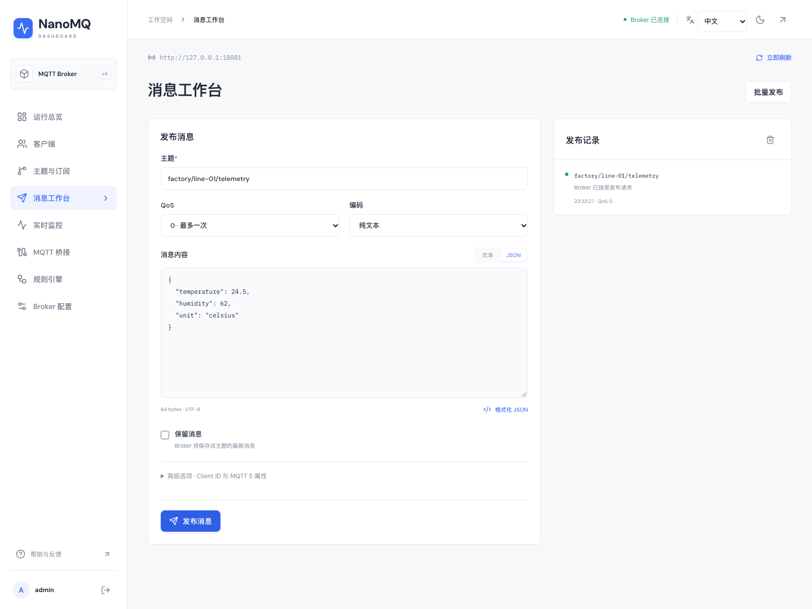

### Configuration / Broker 配置

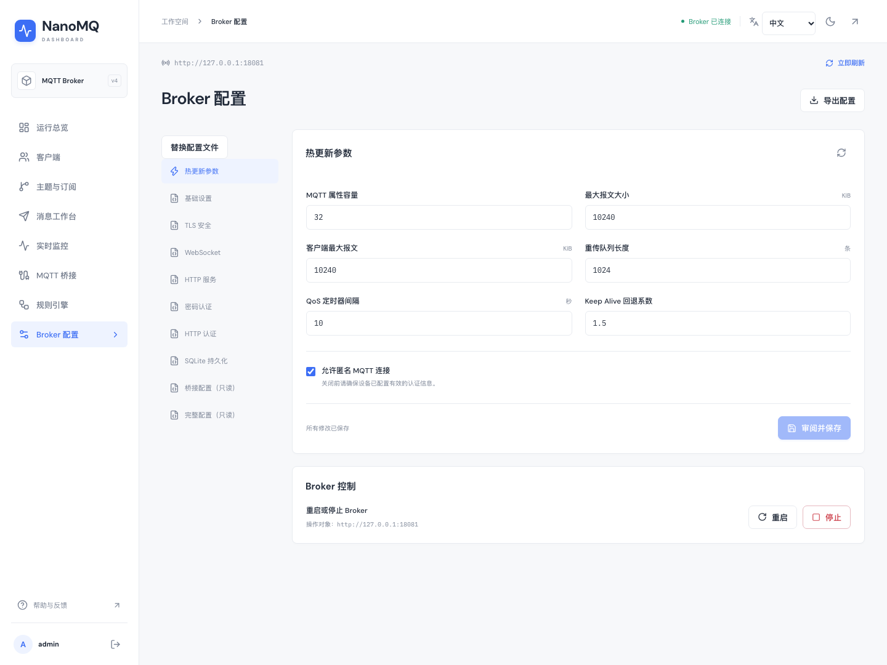

<details>
<summary>Connection / 连接 Broker</summary>

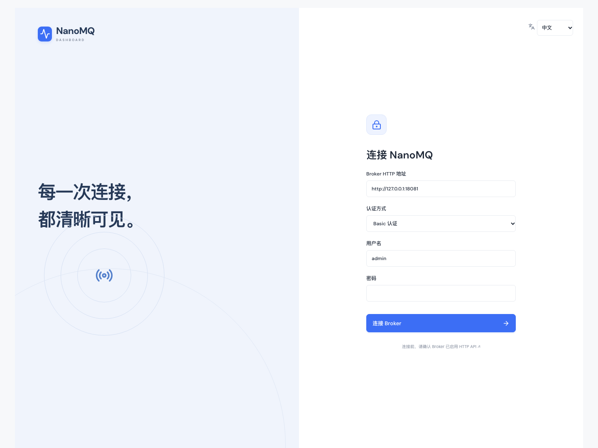

</details>

<details>
<summary>Dark mode / 深色模式</summary>

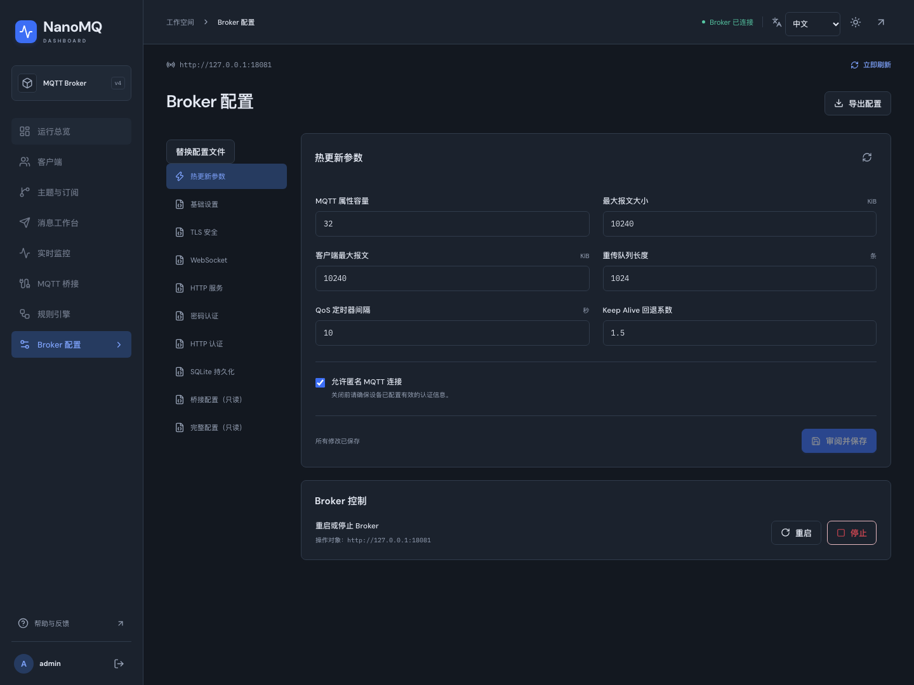

</details>

<details>
<summary>Mobile / 移动端</summary>

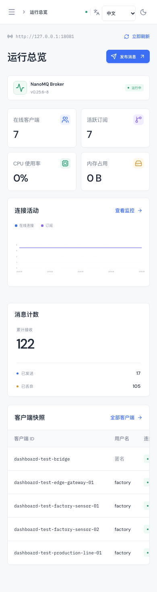

</details>

## License / 许可证

[MIT](LICENSE). Bundled fonts retain their [DM Sans](public/fonts/OFL-DM-Sans.txt) and [IBM Plex Mono](public/fonts/OFL-IBM-Plex-Mono.txt) Open Font Licenses. This community dashboard is independent of the NanoMQ project.

字体分别遵循 [DM Sans](public/fonts/OFL-DM-Sans.txt) 与 [IBM Plex Mono](public/fonts/OFL-IBM-Plex-Mono.txt) 的开放字体许可证。本社区控制台独立于 NanoMQ 官方项目。
